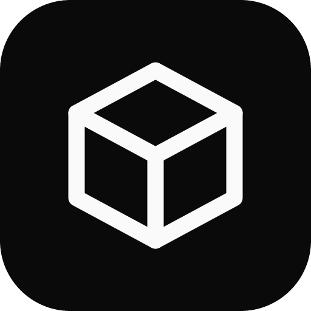
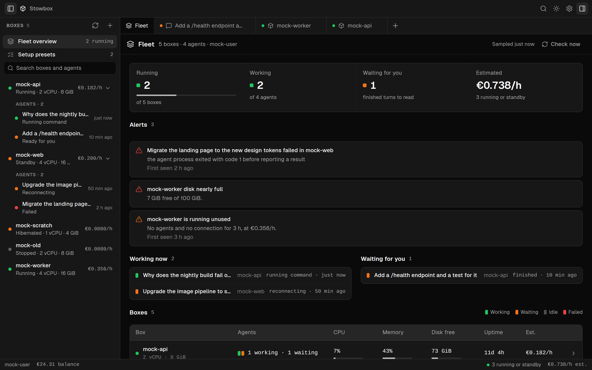
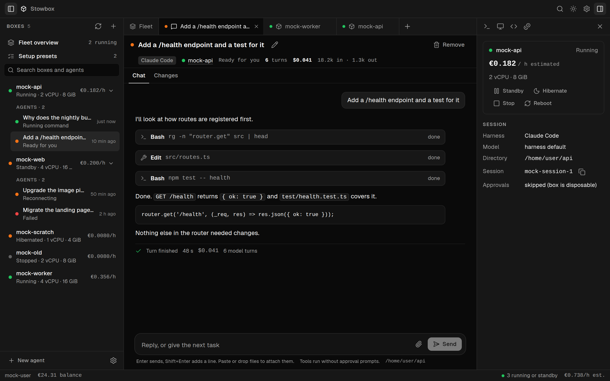
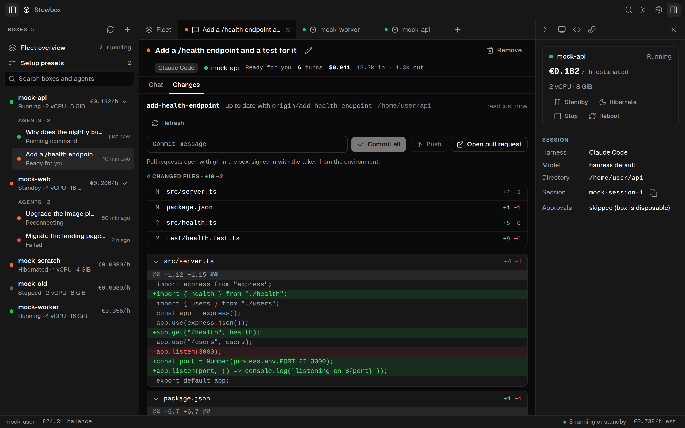
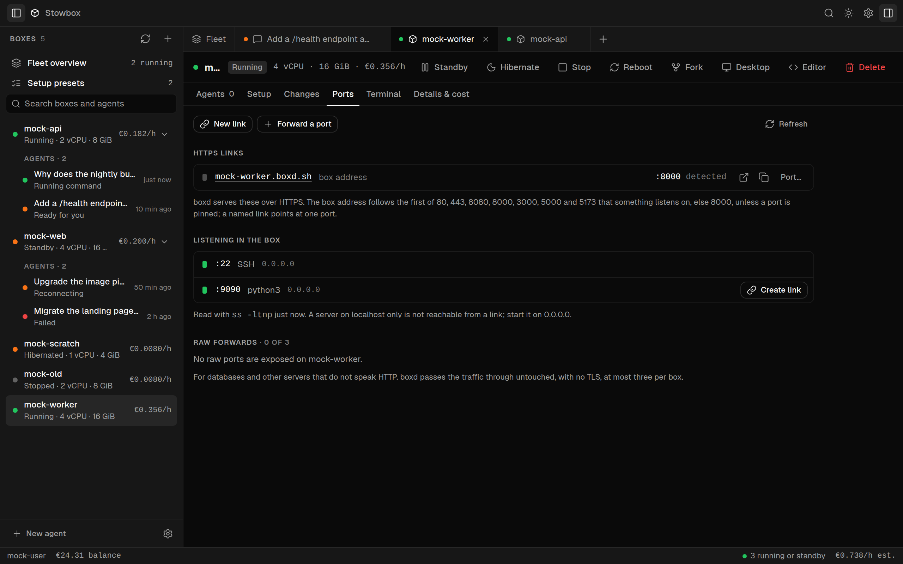
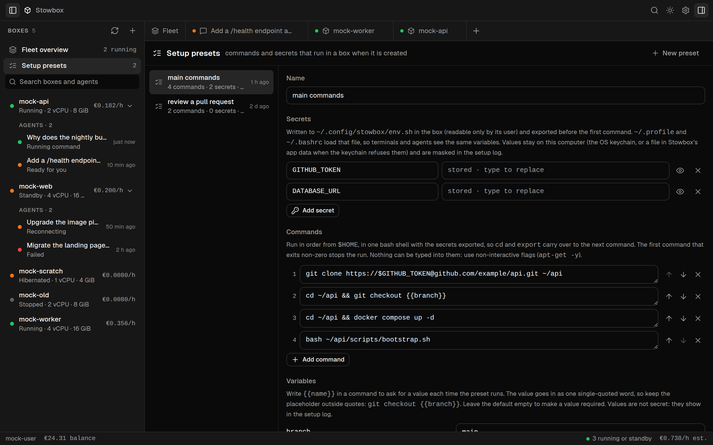
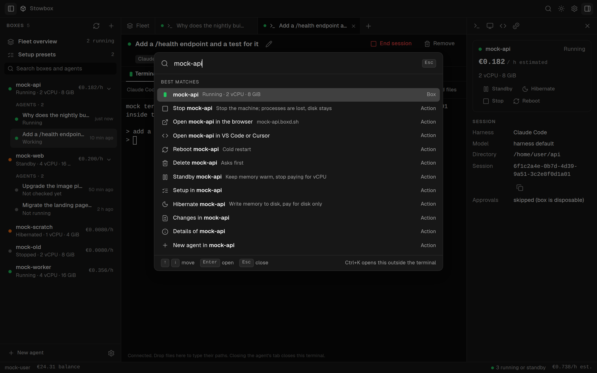
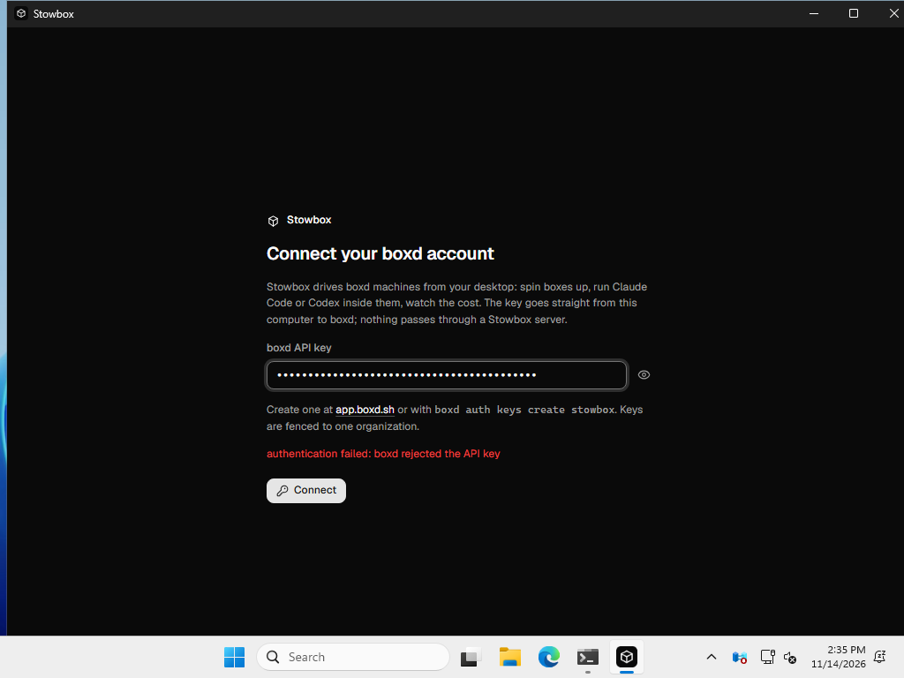
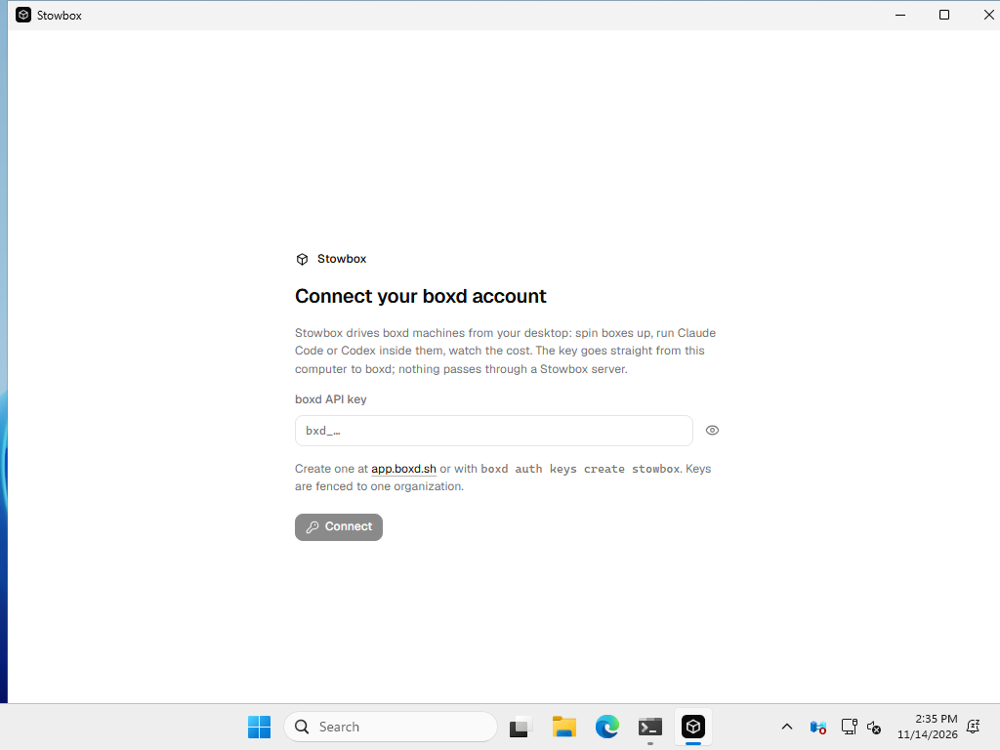

<p align="center">
  
</p>

<h1 align="center">Stowbox</h1>

<p align="center">
  <a href="https://github.com/edumntg/stowbox/actions/workflows/ci.yml"></a>
  <a href="https://github.com/edumntg/stowbox/actions/workflows/windows-smoke.yml"></a>
  <a href="https://github.com/edumntg/stowbox/stargazers"></a>
  <a href="https://github.com/edumntg/stowbox/releases"></a>
  <a href="#license"></a>
  
</p>

<p align="center"><b>A desktop cockpit for cloud boxes and the coding agents running in them.</b></p>

Stowbox talks to [boxd](https://boxd.sh), [boat](https://boat.dev) and
[Daytona](https://www.daytona.io) with your own API keys, from your computer;
connect one or several. It shows your boxes with a
live cost estimate, runs Claude Code or Codex inside them, one terminal and one
session per agent, opens a shell in any box, and pauses, stops, forks or deletes
a box from the same window, with whatever each provider supports. There is no
Stowbox server: the keys and the boxes never leave your machine and the provider.

Built with Tauri 2 (Rust) and SolidJS: it starts in a blink and idles at a few
tens of megabytes.

<p align="center">
  <a href="https://github.com/edumntg/stowbox/releases/latest"><b>Download Stowbox</b></a>
  &nbsp;·&nbsp; macOS, Windows and Linux
</p>

<p align="center">
  
</p>

## Features

### Agents in boxes

A Claude Code or Codex session pinned to a box and a directory, in the
harness's own interface: every agent gets its own terminal on its own session,
so `/login`, `/status`, approvals and everything else work as they do locally.
Start as many as you like, side by side in tabs. In a box with tmux the agent
keeps running when you close its tab, the laptop or the app, and opening it
again attaches to the same session. Claude Code's hooks tell Stowbox whether an
agent is working or waiting for you, with a notification when a turn ends.
Drop files on the terminal to copy them into the box and type their paths, or
give each agent its own git worktree so several can work on one repository
without touching each other's files.

<p align="center"></p>

### Changes and pull requests

Every agent and box has a Changes tab that reads the repository inside the box:
branch, ahead and behind, changed files, the full diff. Commit, push and open a
pull request from there, with `gh` in the box or the host's compare page.

<p align="center"></p>

### Ports and links

See a dev server in the browser: the box's HTTPS links on boxd's proxy, named
links pinned to one port, raw TCP and UDP forwards for databases, and what is
listening inside the box, with a warning for servers bound to localhost only.

<p align="center"></p>

### Setup presets

A named list of commands and secrets that runs in a box as soon as it boots,
or later from its Setup tab. Secrets stay in the OS keychain on your computer
and are masked in the log. `{{placeholders}}` in a command ask for a value
each run.

<p align="center"></p>

### Command palette

⌘K or Ctrl+K jumps to any box, agent or preset and runs the common actions.

<p align="center"></p>

### Fleet and cost

One landing view: running boxes, working agents, agents waiting for you, the
estimated cost per hour, and alerts derived from the same data (a box billing
with nothing to do, a box near its memory or disk limit). Two optional guards: idle standby after N quiet minutes, and a daily
spend warning.

### Native on Windows, macOS and Linux

Windows keeps its own title bar and follows the app's theme. The terminal
copies with Ctrl+C and pastes with Ctrl+V as Windows Terminal does. The
Windows build is driven through onboarding in CI on every change to the app.

<p align="center">
  
  
</p>

### Also in the box

- **Boxes**: create, fork, standby, resume, hibernate, wake, stop, start,
  reboot, delete; size and cost per hour per box, metered usage per box.
- **Terminal**: an interactive shell in the box over boxd's exec stream,
  nothing to install locally.
- **Open in VS Code or Cursor** over Remote-SSH, with a key Stowbox makes and
  a `Host stowbox-<box>` entry it manages in `~/.ssh/config`.
- **Desktop**: boxd's live desktop view of the box, one click away.
- **Notifications** when an agent's turn or a setup run ends, with a dock or taskbar
  badge; clicking one brings the agent back.
- Light and dark themes, keyboard reachable, honest empty, loading and error
  states everywhere.

The full list, with every detail of how each feature behaves, is in
[docs/features.md](docs/features.md).

## Supported agents

[Claude Code](https://docs.anthropic.com/en/docs/claude-code) and
[Codex](https://github.com/openai/codex), both preinstalled on boxd machines.
Stowbox handles no Anthropic or OpenAI credentials: the agent signs in with
what the box already has, an `ANTHROPIC_API_KEY` or `OPENAI_API_KEY` set as a
boxd secret (`boxd env set ANTHROPIC_API_KEY sk-ant-… --secret`), a
`CLAUDE_CODE_OAUTH_TOKEN` from `claude setup-token`, or the login boxd stores
for your organization. A box can also keep a Claude Code login of its own
(its Agents tab), so two boxes can use two accounts; `/login` runs in any
agent's terminal.

## Install

Installers for every release are on the
[Releases](https://github.com/edumntg/stowbox/releases/latest) page:

| Platform | File |
| --- | --- |
| macOS (Apple Silicon and Intel) | `Stowbox_x.y.z_universal.dmg` |
| Windows 10 and 11, 64-bit | `Stowbox_x.y.z_x64-setup.exe` or `.msi` |
| Linux | `.AppImage` or `.deb` |

The builds are not signed yet. On macOS allow the app under System Settings,
Privacy & Security, Open Anyway, or run
`xattr -dr com.apple.quarantine /Applications/Stowbox.app`. On Windows,
SmartScreen asks once: More info, Run anyway. Windows 10 may need the
[WebView2 runtime](https://developer.microsoft.com/microsoft-edge/webview2/),
which the installer fetches when it is missing.

On first launch the app asks for an API key: boxd (`bxd_…`, from
[app.boxd.sh](https://app.boxd.sh) or `boxd auth keys create stowbox`) or boat
(`boat_…`, from the boat dashboard or `boat api-key create stowbox`, with the
ssh action) or Daytona (`dtn_…`, from the Daytona dashboard under Keys). The
others can be added later in Settings. Keys go to the OS keychain (Windows
Credential Manager on Windows) and never to a Stowbox server. What differs
between the providers is in [docs/boat.md](docs/boat.md) and
[docs/daytona.md](docs/daytona.md).

Platform notes for Windows (OpenSSH for the editor integration, where secrets
live, CI): [docs/windows.md](docs/windows.md).

### Updates

An installed Stowbox looks for a newer release on GitHub when it starts and
every 6 hours. When there is one, the status bar says so: click it to download
the update, check its signature, install it and restart. Settings, Version,
checks by hand. On Linux this works for the AppImage; a `.deb` is updated by
installing the new `.deb`.

### Install from source

To use Stowbox day to day without `pnpm tauri dev`, build the installer once
and install it like any other app (prerequisites under
[Build from source](#build-from-source)):

```sh
git clone https://github.com/edumntg/stowbox && cd stowbox
pnpm install
pnpm tauri build
```

The first build takes a few minutes. Then install what it made, in
`target/release/bundle/`:

| Platform | Install |
| --- | --- |
| macOS | Open `macos/Stowbox.app`'s folder and drag the app to Applications, or open the `.dmg` in `dmg/` |
| Windows | Run `nsis/Stowbox_x.y.z_x64-setup.exe` (or the `.msi` in `msi/`) |
| Debian, Ubuntu | `sudo apt install ./target/release/bundle/deb/Stowbox_x.y.z_amd64.deb` |
| Other Linux | `pnpm tauri build --bundles appimage`, then run `appimage/Stowbox_x.y.z_amd64.AppImage` (`chmod +x` it first) |

Stowbox then starts from the app menu, the Start menu or Spotlight, with no
terminal. A build of your own is not signed with the release key, so it does
not take updates from the status bar; installing a release over it does.

## Build from source

Rust 1.80+ ([rustup](https://rustup.rs)), Node 22+ with pnpm, and the
[Tauri 2 prerequisites](https://tauri.app/start/prerequisites/) for your OS.

```sh
git clone https://github.com/edumntg/stowbox && cd stowbox
pnpm install
pnpm tauri dev        # the desktop app with hot reload
pnpm tauri build      # installers in target/release/bundle/, see Install from source
pnpm dev              # the UI alone in a browser, on mock data
```

Everything else for working on it, from the browser build and the Rust tests
to the layout of the repository and how boxd is used, is in
[docs/development.md](docs/development.md). Releases and signing:
[docs/releasing.md](docs/releasing.md). Design rules: [DESIGN.md](DESIGN.md).

## License

No license has been chosen for this repository yet.

## Credits

Icons are [Phosphor Icons](https://phosphoricons.com) (bold weight), MIT,
inlined in `src/icons`. Terminal rendering by [xterm.js](https://xtermjs.org).
Boxes by [boxd](https://boxd.sh), [boat](https://boat.dev) and [Daytona](https://www.daytona.io).
